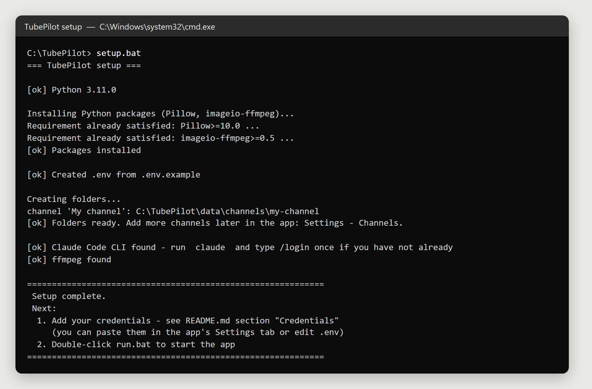
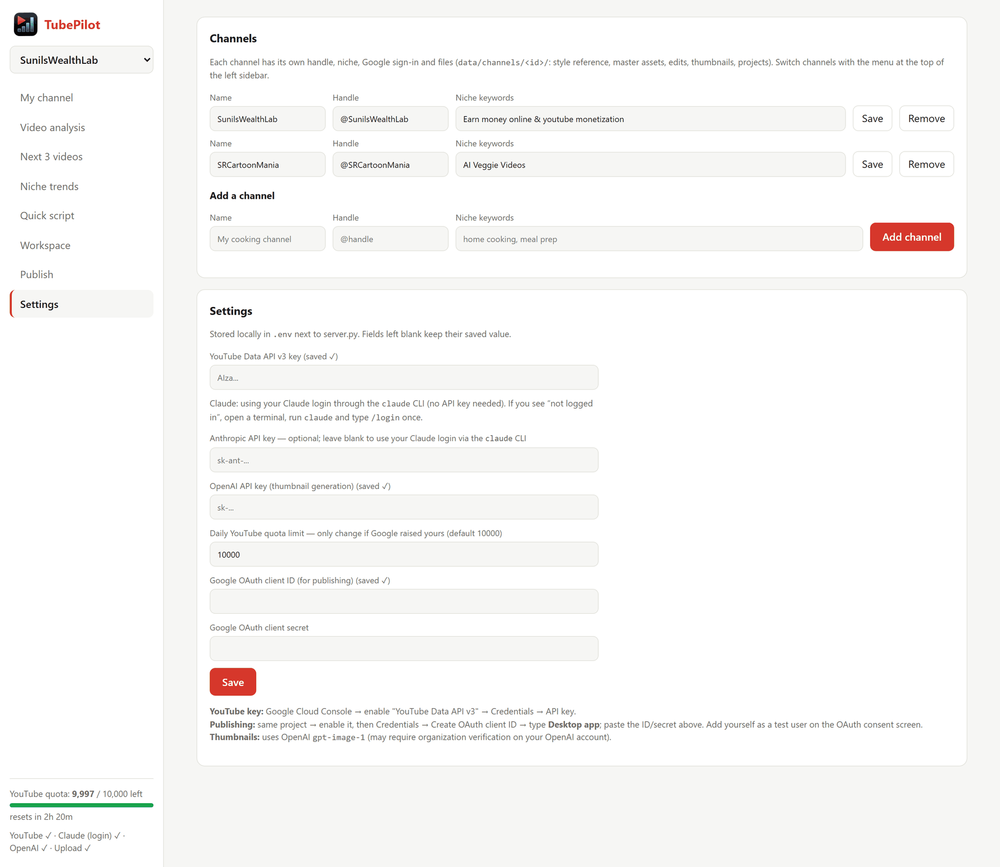
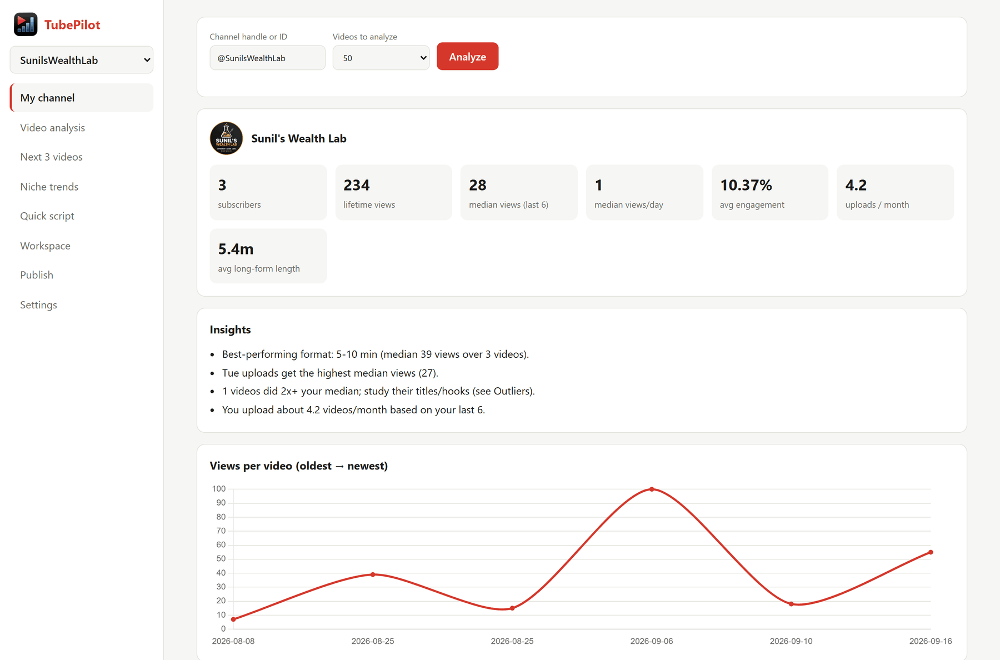
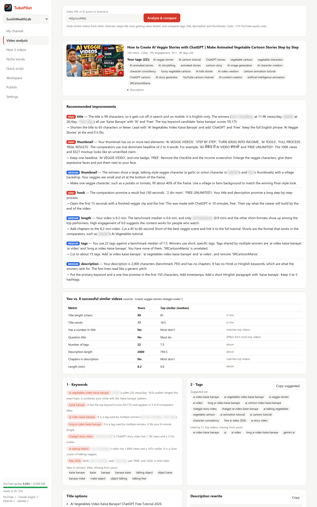
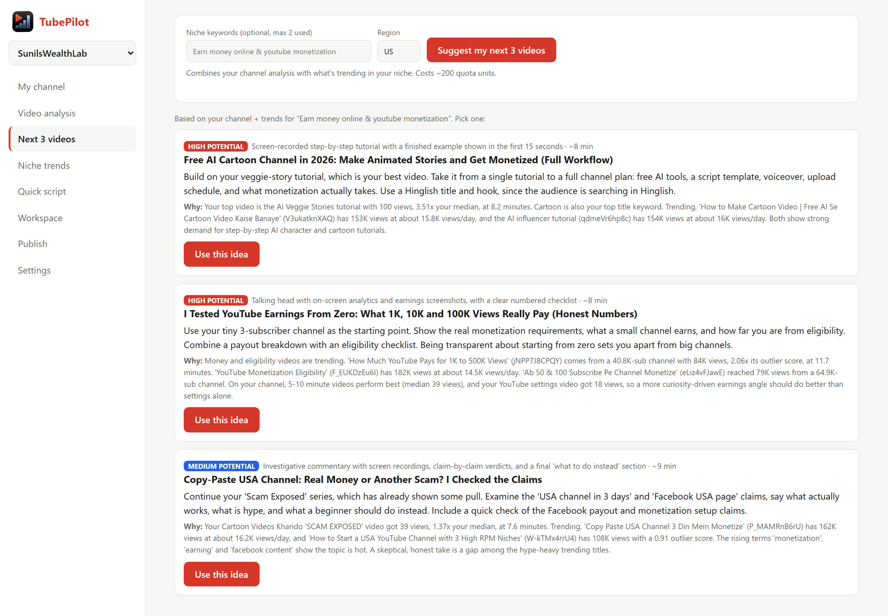
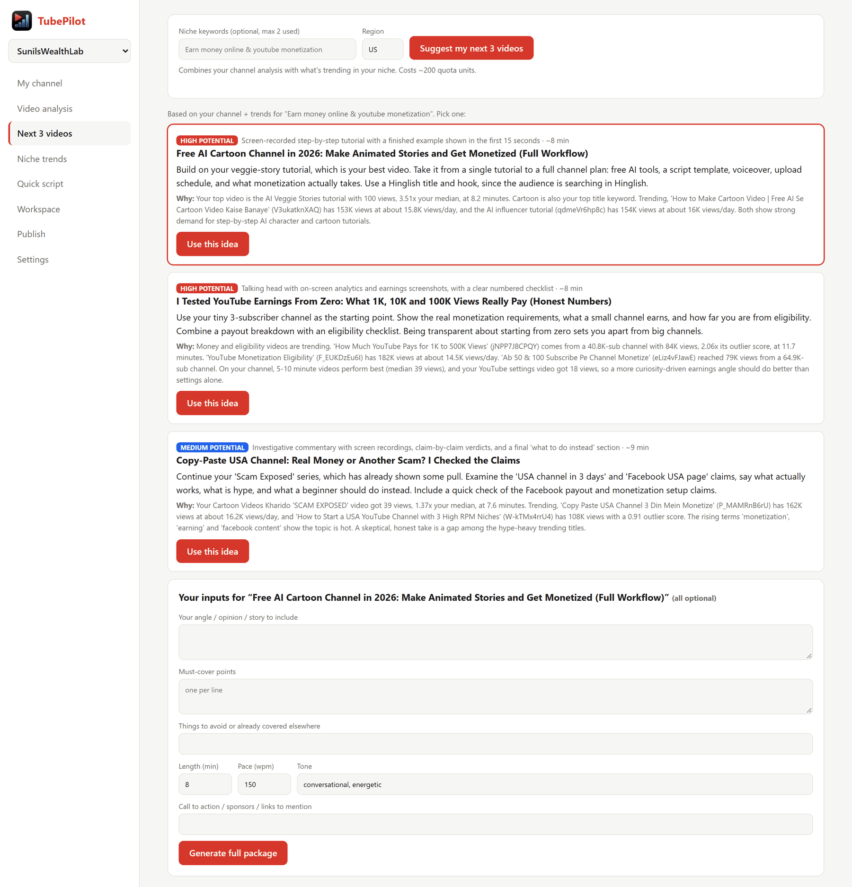
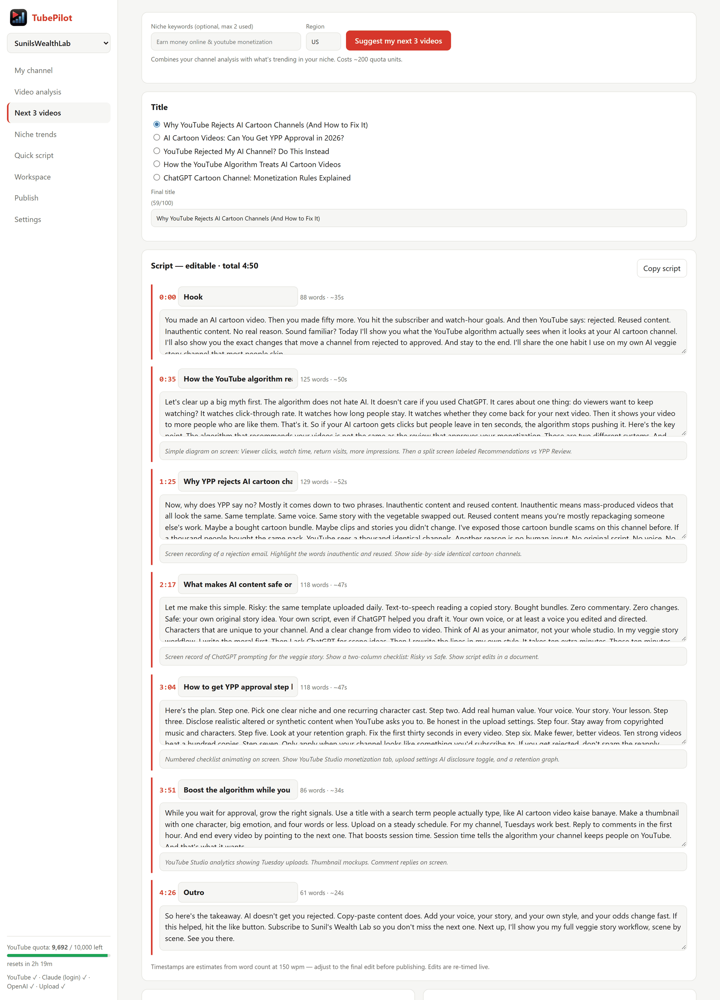
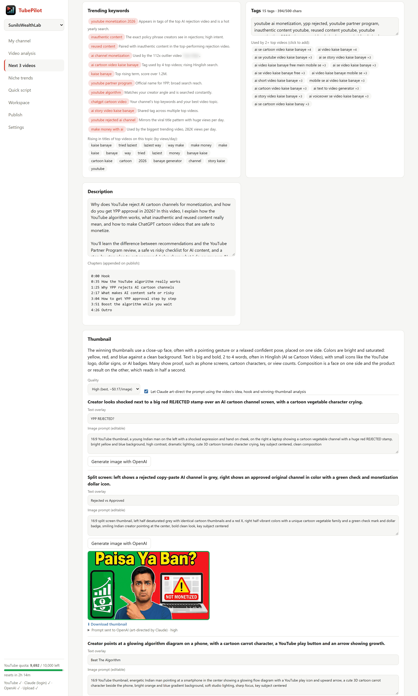
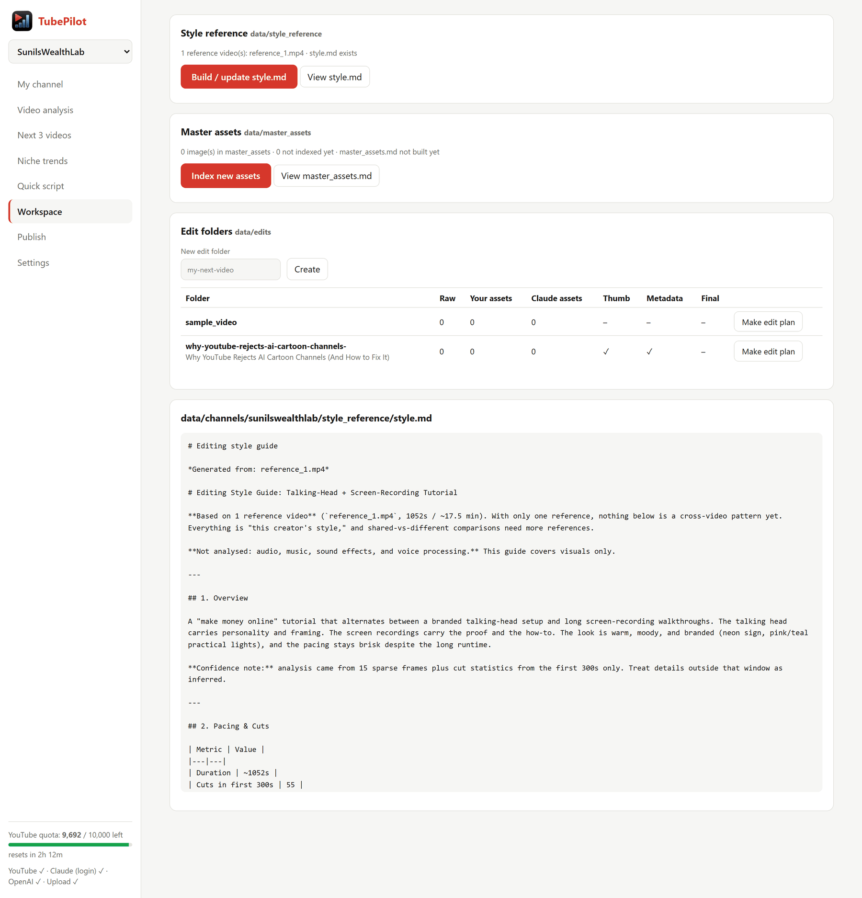
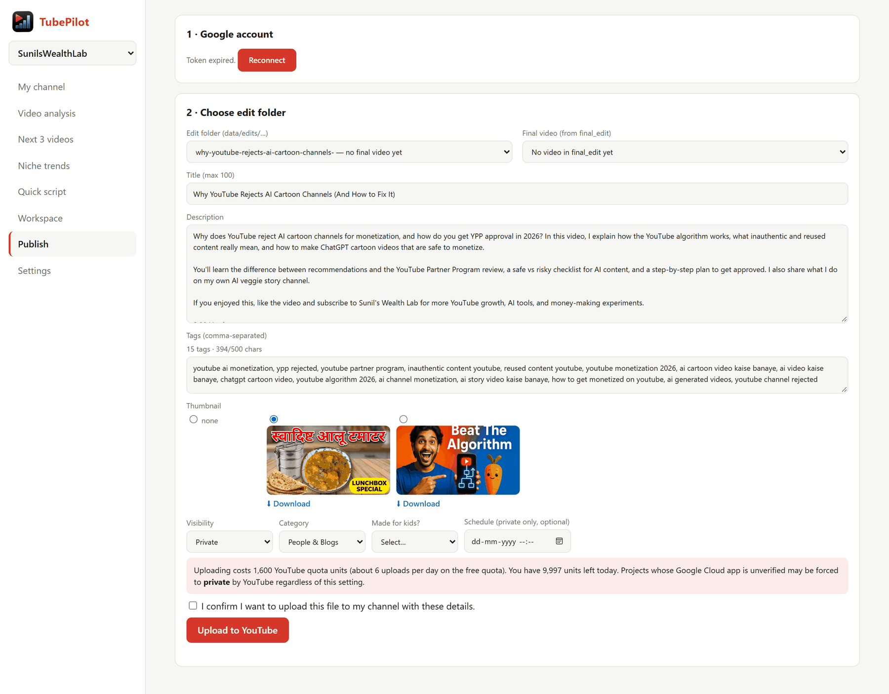

<p align="center">
  
</p>

<h1 align="center">TubePilot</h1>

<p align="center">
  <b>Your local co-pilot for growing a YouTube channel.</b><br>
  Analyze your channel, learn from what's winning in your niche, get the next three video ideas with a full package<br>
  (script with timestamps, title, description, tags, thumbnails), plan the edit, and publish, all from one browser tab on your own computer.
</p>

<p align="center">
  <a href="LICENSE"></a>
  
  
  
</p>

---

## Contents

1. [What TubePilot does](#1-what-tubepilot-does)
2. [Requirements](#2-requirements)
3. [Install and set up](#3-install-and-set-up)
4. [Credentials: get every key and sign-in](#4-credentials-get-every-key-and-sign-in)
5. [Using TubePilot (walkthrough)](#5-using-tubepilot-walkthrough)
6. [Folder structure](#6-folder-structure)
7. [Costs and quota](#7-costs-and-quota)
8. [Configuration reference](#8-configuration-reference)
9. [The `edit.py` helper](#9-the-editpy-helper)
10. [Troubleshooting](#10-troubleshooting)
11. [Privacy and security](#11-privacy-and-security)
12. [Project layout](#12-project-layout)
13. [Development](#13-development)
14. [License and disclaimer](#14-license-and-disclaimer)

> **About the screenshots:** they were taken from the real app with a real channel. Other creators' names are blurred and their thumbnails are left out.

---

## 1. What TubePilot does

TubePilot runs on your computer and opens in your browser. It connects to the YouTube Data API, to Claude (for analysis and writing) and to OpenAI (for thumbnail images), using **your own keys**. Nothing is sent to any TubePilot server, because there isn't one.

| Screen | What you get |
|---|---|
| **My channel** | Subscribers, median views, views per day, engagement, upload cadence, best upload day and video length, your top and weakest videos, and the title keywords that move your views. |
| **Video analysis** | Pick any video (yours or anyone's). TubePilot finds similar videos from *other* channels that are performing well and compares tags, title, description, length and thumbnails. You get prioritized fixes, missing keywords and tags, title options, a description rewrite and thumbnail ideas. |
| **Next 3 videos** | Three video ideas that combine what already works on your channel with what is trending in your niche. Pick one and TubePilot builds the whole package: an **editable script with timestamps**, trending keywords, tags, titles, description and **AI-generated thumbnails**. |
| **Niche trends** | What is rising in your niche right now, and small channels whose videos are beating their size (the best topics to adapt). |
| **Quick script** | A one-shot script with timestamps for any topic. |
| **Workspace** | Builds a `style.md` editing-style guide from reference videos you like, indexes your reusable assets into `master_assets.md`, manages one folder per video, and writes an **edit plan** for each. |
| **Publish** | Uploads the finished video from its folder to YouTube with the title, description, tags and thumbnail you prepared. |
| **Multiple channels** | Switch between channels from the sidebar. Each one has its own niche, files and Google sign-in. |
| **Quota meter** | The sidebar always shows how much of your daily YouTube API quota is left. |

**The workflow it is built around:**

```
My channel ─► Video analysis ─► Next 3 videos ─► Save to edit folder ─► Make edit plan ─► you edit ─► Publish
 (what works)   (learn from       (idea + script    (metadata.txt,        (uses your style      (final_edit/)  (upload)
                 winners)          + thumbnail)      script.md, thumb)     guide + assets)
```

---

## 2. Requirements

- **Windows 10/11 or macOS** (Intel and Apple Silicon). Linux also works with the same scripts as macOS.
- **Python 3.9 or newer.** Windows: from [python.org](https://www.python.org/downloads/), and in the installer tick **"Add python.exe to PATH"**. macOS: from [python.org](https://www.python.org/downloads/macos/) or `brew install python` (the Xcode command line tools' Python 3.9 also works).
- A **Google account** that owns your YouTube channel.
- A modern browser (Chrome, Edge, Firefox).
- Optional: **ffmpeg + ffprobe** on your PATH, only for the [`edit.py`](#9-the-editpy-helper) cutting helper. Style analysis works without it (a copy of ffmpeg is installed with the pip packages). macOS: `brew install ffmpeg`.

You do **not** need Node, Docker or a database. The server uses only Python's standard library; the only pip packages are Pillow, imageio-ffmpeg and certifi (HTTPS certificates, needed on macOS).

---

## 3. Install and set up

### Step 1: Get the code

Either clone it:

```bash
git clone https://github.com/sunilrastogi/TubePilot.git
```

or click **Code → Download ZIP** on GitHub and extract it anywhere (for example `C:\TubePilot` on Windows, `~/TubePilot` on a Mac).

### Step 2: Run the setup script

| | Windows | macOS (and Linux) |
|---|---|---|
| **Run** | double-click **`setup.bat`** | double-click **`setup.command`** in Finder, or in Terminal: `cd ~/TubePilot && ./setup.command` |
| **Where packages go** | your user Python | a private virtual environment in `.venv/` (this avoids the "externally-managed-environment" error that Homebrew Python gives) |

> **macOS, first time only.** If macOS says *"setup.command can't be opened because Apple cannot check it"* (it flags files downloaded as a ZIP), right-click the file → **Open** → **Open**, or run `xattr -dr com.apple.quarantine ~/TubePilot` once in Terminal. If Terminal says *"permission denied"*, run `chmod +x setup.command run.command`.

The script does everything for you. It:

1. checks that Python 3.9+ is installed (and opens the download page if not),
2. installs the pip packages (Pillow, imageio-ffmpeg, certifi),
3. creates your `.env` file from `.env.example`,
4. creates the full folder structure for your first channel (see [Folder structure](#6-folder-structure)), including a `sample_video` template with all the editing sub-folders,
5. tells you whether the optional tools (Claude CLI, ffmpeg) were found.

<p align="center"></p>

It is safe to run again at any time. It never overwrites your `.env` or your data.

### Step 3: Add your credentials

You need only the YouTube key to start. See [Credentials](#4-credentials-get-every-key-and-sign-in) for exactly where to get each one. You can paste them into the app (step 4) or edit `.env` in any text editor.

### Step 4: Start TubePilot

Windows: double-click **`run.bat`**. macOS: double-click **`run.command`** (or run `./run.command` in Terminal).

The server starts and your browser opens at **http://127.0.0.1:8791**. Keep the console window open while you use TubePilot; close it (or press `Ctrl+C`) to stop the app. If you skipped Step 2, the launcher runs the setup for you on first start.

Go to **Settings** (bottom of the left sidebar), paste your keys, click **Save**, and add your channel:

<p align="center"></p>

- **Channels:** give each channel a name, its `@handle` and a few niche keywords (for example `home cooking, meal prep`). The niche is used as the default for trend searches and idea generation.
- **Keys:** every field shows **(saved ✓)** once stored. The values are never shown again; leave a field blank to keep the saved value.
- **Sidebar footer:** `YouTube ✓ · Claude ✓ · OpenAI ✓ · Upload ✓` shows which services are ready, and the quota meter shows what is left of today's YouTube quota.

---

## 4. Credentials: get every key and sign-in

| Credential | Needed for | Required? |
|---|---|---|
| [YouTube Data API key](#41-youtube-data-api-key) | Channel stats, trends, video comparison | **Yes** |
| [Claude login **or** Anthropic API key](#42-claude-pick-one) | All analysis, ideas, scripts, edit plans, style guide | Yes, for the AI features |
| [OpenAI API key](#43-openai-api-key-thumbnails) | Thumbnail generation, `edit.py` transcription | Optional |
| [Google OAuth client](#44-google-oauth-publishing-to-youtube) | Publishing to YouTube | Optional |

Everything below can be entered in **Settings** or in `.env`. Keys are stored only in `.env` on your computer.

### 4.1 YouTube Data API key

1. Go to <https://console.cloud.google.com> and sign in with your Google account.
2. Create a project (top bar → project picker → **New project**), or pick an existing one.
3. Open **APIs & Services → Library**, search for **YouTube Data API v3** and click **Enable**.
4. Open **APIs & Services → Credentials → Create credentials → API key**. Copy the key.
5. *(Recommended)* click **Edit API key → API restrictions → Restrict key → YouTube Data API v3**, then **Save**.
6. In TubePilot: **Settings → YouTube Data API v3 key**, paste, **Save**.

The free quota is **10,000 units per day**. See [Costs and quota](#7-costs-and-quota).

### 4.2 Claude (pick one)

TubePilot uses Claude to analyze videos, suggest ideas and write scripts.

**Option A: use your Claude subscription (no API key).**

1. Install Claude Code from <https://claude.com/claude-code>.
2. Open a terminal, run `claude`, then type `/login` and sign in.
3. Leave the Anthropic key blank in TubePilot. The sidebar shows **Claude (login) ✓**.

Calls go through the `claude` command-line tool and count against your plan's usage limits. Each big request (a full package) can take a minute or two.

**Option B: use an Anthropic API key.**

1. Create a key at <https://console.anthropic.com/settings/keys>.
2. Paste it into **Settings → Anthropic API key** and **Save**. If a key is set, it is used instead of the CLI.

### 4.3 OpenAI API key (thumbnails)

1. Create a key at <https://platform.openai.com/api-keys> and add some billing credit.
2. Paste it into **Settings → OpenAI API key** and **Save**.

Thumbnails use `gpt-image-1`, which can require organization verification in your OpenAI account (**Settings → Organization → Verify**). High quality costs roughly **$0.17 per image** and medium roughly **$0.04** (check OpenAI's current pricing). TubePilot first asks Claude to write an art-directed brief from your video's idea, hook and the winning thumbnails in your niche, so each image is specific to the video.

### 4.4 Google OAuth (publishing to YouTube)

You only need this for the **Publish** tab. Use the **same Google Cloud project** as your API key.

**A. Configure the consent screen**

1. In the Cloud Console open **APIs & Services → OAuth consent screen** (it may be called **Google Auth Platform**).
2. Choose **External** and fill in an app name (anything, for example "TubePilot") and your email.
3. Leave the publishing status as **Testing**.
4. Under **Audience → Test users → Add users**, add the Google account that owns your YouTube channel.
5. Under **Data access / Scopes**, add:
   - `https://www.googleapis.com/auth/youtube.upload`
   - `https://www.googleapis.com/auth/youtube.readonly`

**B. Create the client**

1. Go to **Credentials → Create credentials → OAuth client ID**.
2. Application type: **Desktop app** (not "Web application").
3. Click **Create**, then copy the **Client ID** and **Client secret**.

**C. Add them to TubePilot and connect**

1. **Settings → Google OAuth client ID** and **client secret** → paste → **Save**.
2. Select your channel in the sidebar, open **Publish** and click **Connect Google account**.
3. Choose the account that owns that YouTube channel. On "Google hasn't verified this app", click **Advanced → Go to … (unsafe)**. This is expected for your own app in Testing mode.
4. Allow the permissions. You are sent back to TubePilot, and Publish shows the connected channel.

Good to know:

- Each channel in TubePilot signs in **separately**. Repeat the connect step for every channel you publish to.
- While the consent screen is in **Testing**, Google expires the sign-in after **7 days**. Publish then shows **Token expired → Reconnect** (you can see this state in the Publish screenshot below). One click reconnects.
- Uploads from unverified API projects may be forced to **Private** by YouTube. Check the video in YouTube Studio after your first upload.
- The app must run on port **8791** (the default), because the sign-in redirect uses it.

---

## 5. Using TubePilot (walkthrough)

Use the left sidebar to move between screens. The channel menu at the top switches the active channel, and the quota meter at the bottom shows what is left of today's YouTube quota.

### 5.1 My channel: see what works

Pick **My channel** and click **Analyze**. TubePilot reads your latest 25, 50 or 100 videos.

<p align="center"></p>

You get the headline numbers, plain-language **insights** (best format, best upload day, how your last videos compare with the ones before), charts for views over time, median views by upload day and by length, your top and weakest videos, and the title keywords that go with your best views. Every video has an **Analyze ›** link that opens the full video-level comparison.

### 5.2 Video analysis: learn from winners

Open **Video analysis**, paste a video URL or ID (or click **Analyze ›** anywhere), and click **Analyze & compare**.

<p align="center"></p>

TubePilot finds similar videos from other channels, keeps the ones gaining views fastest, and then:

- compares **your video to the winners' median** on title length, tags, description length, chapters and duration;
- asks Claude to look at the **thumbnails side by side** and judge yours against the winners;
- lists **prioritized improvements** (high / medium / low) for title, thumbnail, length, hook, tags and description, each with a concrete fix;
- suggests **keywords**, a **tag set** (with a Copy button), **five title options**, a **description rewrite**, and **three thumbnail ideas** you can turn into images with one click.

Every thumbnail (yours and the winners') has a **⬇ Download** link.

### 5.3 Next 3 videos: from idea to full package

Open **Next 3 videos**, optionally type niche keywords (the default comes from your channel's niche), and click **Suggest my next 3 videos**.

<p align="center"></p>

Each idea says *why* it should work, citing your own results and specific trending videos. Click **Use this idea**, then answer the optional questions (your angle or story, must-cover points, things to avoid, length, pace, tone, call to action):

<p align="center"></p>

Click **Generate full package**. After a minute or two you get an editable package:

**Title and script, with live timestamps.** Choose one of five titles or write your own. Every section of the script is editable, and the timestamps re-time as you type (based on your speaking pace, 150 words per minute by default). The chapter list updates itself.

<p align="center"></p>

**Keywords, tags, description and thumbnails.** Trending keywords come with the reason each one matters. Tags are pre-filled, and you can click tags used by several top videos to add them (a live counter shows your usage against YouTube's 500-character tag limit). Then comes the description with auto-built chapters, and thumbnail concepts based on an analysis of the trending thumbnails.

<p align="center"></p>

**Thumbnail generator.** Edit the text overlay or the image prompt, choose High or Medium quality, and click **Generate image with OpenAI**. With the *art-direct* box ticked, Claude rewrites the prompt using the video's idea, hook and the winning thumbnails first. The exact prompt that was sent is shown under each image, so you can learn what works. Click an image to select it for publishing, or **⬇ Download thumbnail** to save it.

When you are happy, scroll to the bottom and click **Save to edit folder**. That creates `data/channels/<channel>/edits/<video>/` with `metadata.txt`, `script.md` and your chosen thumbnail.

### 5.4 Niche trends and Quick script

- **Niche trends:** enter up to four keywords and a time window (3, 7 or 30 days). You get rising title terms, **small channels beating their size** (views higher than their subscriber count: the best topics to adapt), and every result ranked by momentum (views per day). Each keyword costs 100 quota units.
- **Quick script:** a topic, length, tone and notes in, a script with timestamps, chapters, titles and tags out. Use it when you don't need the full package.

### 5.5 Workspace: style guide, assets and edit plans

<p align="center"></p>

The Workspace turns your folders into an editing assistant:

- **Style reference.** Put 1 to 5 videos whose editing you like into `style_reference/`, then click **Build / update style.md**. TubePilot samples frames (with extra coverage of the opening seconds), counts the cuts, and has Claude write a concrete style guide: pacing with numbers, framing, on-screen text, colour, graphics, b-roll, how the video opens, and a do/don't list. It cannot hear audio, so the guide says so instead of guessing about music. Add your own rules under the `MANUAL NOTES` line; they survive regeneration.
- **Master assets.** Drop your photos, logos and other reusable files into `master_assets/` and click **Index new assets**. Claude describes each image and notes what it suits, in `master_assets.md`. Existing rows are never overwritten, so you can hand-edit them.
- **Edit folders.** One folder per video, with a status table (raw footage, your assets, Claude assets, thumbnail, metadata, final video). **Make edit plan** reads the script, your `style.md`, your asset index and the files in that folder, and writes `edit_plan.md`: a timeline table (timestamp, script beat, what is on screen, text and graphics, cuts and sound), the exact files to use, and a list of assets still to generate with a ready-made prompt for each. It only references files that really exist.

### 5.6 Publish

<p align="center"></p>

1. **Google account.** Shows the connected channel, or **Connect / Reconnect** (as in the screenshot, where the 7-day Testing-mode sign-in has expired).
2. **Choose edit folder.** The title, description (with chapters), tags and thumbnail load from that folder's `metadata.txt` and `thumbnail and metadata/`. The video comes from `final_edit/`. Everything is editable before upload.
3. Pick the **visibility** (defaults to **Private**), category, whether the video is **made for kids** (you must choose), and an optional schedule.
4. Tick **"I confirm I want to upload…"** and click **Upload to YouTube**. A progress bar follows the upload, and TubePilot sets the thumbnail afterwards.

An upload costs 1,600 quota units (about 6 per day on the free quota). The page tells you how many units you have left and warns you if there are not enough.

---

## 6. Folder structure

`setup.bat` creates all of this. Everything under `data/` is **your personal content and is git-ignored**.

```
data/
├── channels.json                 Your channels: id, name, handle, niche (edit in Settings → Channels)
├── quota.json                    Today's counted YouTube quota usage
└── channels/
    └── <channel-id>/             One complete workspace per channel
        ├── style_reference/          Videos whose editing style you like (1-5)
        │   └── style.md              Generated style guide
        ├── master_assets/            Reusable pictures, logos and assets
        │   └── master_assets.md      Generated index of what each file is and what it suits
        ├── edits/
        │   └── <video-name>/         One folder per video (template: sample_video)
        │       ├── raw_video/            Your raw footage
        │       ├── claude_assets/        Assets generated by Claude and the tools
        │       ├── user_assets/          Assets you provide for this video
        │       ├── thumbnail and metadata/   thumbnail.jpg + metadata.txt
        │       ├── final_edit/           The finished video that gets published
        │       ├── script.md             Saved from "Next 3 videos → Save to edit folder"
        │       └── edit_plan.md          Generated by Workspace → "Make edit plan"
        ├── thumbs/                   Thumbnails generated with OpenAI
        ├── projects/                 Saved drafts from "Next 3 videos"
        └── tokens.json               This channel's Google sign-in
```

`metadata.txt` is plain text you can edit by hand:

```
TITLE: Why YouTube Rejects AI Cartoon Channels (And How to Fix It)

DESCRIPTION:
Why does YouTube reject AI cartoon channels for monetization...

TAGS: youtube ai monetization, ypp rejected, youtube partner program
KEYWORDS: youtube monetization 2026, inauthentic content
CHAPTERS:
0:00 Hook
0:35 How the YouTube algorithm really works
```

Removing a channel in Settings only removes it from the list; its folder stays on disk. If you used an earlier single-channel version, your existing data is moved into your first channel automatically on the next start.

---

## 7. Costs and quota

**YouTube quota.** The free allowance is 10,000 units per day per Google Cloud project. The sidebar meter counts your usage locally from Google's published costs (YouTube has no API for "quota left"): search 100, upload 1,600, thumbnail 50, everything else 1. Cached results cost nothing, and if Google ever replies "quota exceeded" the meter jumps to empty. It resets at **midnight Pacific time**. It is shared by all channels (the quota belongs to the API key) and only counts calls made by TubePilot. If Google raised your limit, set it in **Settings → Daily YouTube quota limit**. You can ask Google for more under **APIs & Services → YouTube Data API v3 → Quotas → Apply for higher quota**.

| Action | YouTube quota | Other cost |
|---|---|---|
| Channel analysis | ~5 units | none |
| Video comparison | ~210 units | one Claude request |
| Niche trends | ~100 units per keyword | none |
| Next 3 ideas | ~200 units | one Claude request |
| Full package | ~100-200 units | one Claude request (longest) |
| Upload | 1,600 units (about 6 per day) | none |
| Thumbnail (set on upload) | 50 units | none |
| Generate a thumbnail | none | OpenAI image (~$0.04 medium, ~$0.17 high) |
| Style guide, asset index, edit plan | none | Claude requests |

---

## 8. Configuration reference

`setup.bat` creates `.env` from [`.env.example`](.env.example). Never commit it (it is git-ignored).

```ini
YOUTUBE_API_KEY=
ANTHROPIC_API_KEY=        # blank = use the claude CLI login
OPENAI_API_KEY=
GOOGLE_CLIENT_ID=
GOOGLE_CLIENT_SECRET=
CHANNEL=@yourchannel      # only seeds your FIRST channel on first run; manage channels in the app afterwards
NICHE=                    # same: seeds the first channel's niche keywords
# YT_QUOTA_LIMIT=10000    # daily quota shown in the sidebar; change only if Google raised it
# CLAUDE_CLI_MODEL=sonnet
# OPENAI_IMAGE_MODEL=gpt-image-1
```

Other settings: the port can be changed with `set PORT=8800` before `python server.py` (publishing's sign-in expects 8791, so keep the default if you publish).

---

## 9. The `edit.py` helper

A command-line helper that works on the same edit folders. It needs **ffmpeg and ffprobe on your PATH** (Windows: `winget install Gyan.FFmpeg` then reopen the terminal; macOS: `brew install ffmpeg`) and an `OPENAI_API_KEY` (Whisper transcription).

```
python edit.py analyze  <video_folder>                       transcribe and propose cuts for long pauses
python edit.py add-cut  <video_folder> START END "reason"    add a manual cut (repetition, fumble)
python edit.py cut      <video_folder>                       apply approved cuts -> claude_assets/rough_cut.mp4
python edit.py render   <video_folder>                       add user_assets overlays -> final_edit/final.mp4
```

`<video_folder>` is a folder name under the channel's `edits` folder (for example `sample_video`). It works on your first channel by default; add `--channel <id>` (ids are in `data/channels.json`) to use another one, for example `python edit.py --channel cooking-corner cut my-video`.

Overlay files in `user_assets` are named `overlay_MM_SS[_LEN].ext`. For example, `overlay_05_25_20.png` shows full-frame at 5:25 for 20 seconds. Overlay times refer to the cut video, and the main audio keeps playing underneath.

---

## 10. Troubleshooting

| Problem | Fix |
|---|---|
| `python` is not recognised (Windows) | Reinstall Python and tick **Add python.exe to PATH**, then run `setup.bat` again. |
| `python3: command not found` / "no developer tools" (macOS) | Install Python from python.org or `brew install python`; if macOS offers the command line developer tools, accept them. Then run `./setup.command` again. |
| macOS: "can't be opened because Apple cannot check it" | Right-click the file → **Open** → **Open**, or run `xattr -dr com.apple.quarantine ~/TubePilot`. |
| macOS/Linux: `permission denied: ./setup.command` | Run `chmod +x setup.command run.command` (a ZIP download can drop the executable flag). |
| `SSL: CERTIFICATE_VERIFY_FAILED` (macOS) | TubePilot uses the `certifi` package for certificates, which setup installs. If you see it anyway, run `/Applications/Python 3.x/Install Certificates.command` once, or rerun `./setup.command`. |
| Linux: "ensurepip is not available" | `sudo apt install python3-venv`, then run `./setup.command` again. |
| Page doesn't load / `Address already in use` | Another program uses port 8791. Close it, or run `set PORT=8800 && python server.py` (publishing's sign-in needs 8791, so keep the default if you can). |
| "Claude CLI isn't logged in" | Open a terminal, run `claude`, type `/login`. Or add an Anthropic API key in Settings. |
| "Add your YOUTUBE_API_KEY" | Save the key in **Settings**, then retry. |
| `quotaExceeded` | You used the day's quota (see the sidebar meter). It resets at midnight Pacific time; cached results still work meanwhile. |
| "Channel '@x' not found" | Check the handle in **Settings → Channels** (it needs the `@`, or use the `UC…` channel ID). |
| `redirect_uri_mismatch` | The OAuth client must be of type **Desktop app**, and TubePilot must run on port 8791. |
| `access_denied` when connecting | Add your Google account under **Test users** on the OAuth consent screen. |
| "Token expired" in Publish | Normal every 7 days while the consent screen is in Testing. Click **Reconnect**. |
| Publish says the wrong account | Each channel signs in separately. Select the right channel in the sidebar, then **Reconnect** and choose the account that owns it. |
| Uploaded video is Private | Expected for unverified Google Cloud projects. Change the visibility in YouTube Studio. |
| Thumbnail generation fails with a verification error | Verify your organization in the OpenAI dashboard to use `gpt-image-1`. |
| Style guide says ffmpeg is missing | Run `python -m pip install imageio-ffmpeg` (`setup.bat` does this). |
| My files seem to be missing after upgrading | They moved to `data/channels/<first-channel-id>/`. Nothing is deleted. |

---

## 11. Privacy and security

- The server listens on **127.0.0.1 only** and rejects requests from other sites or hostnames.
- Keys live in `.env`, and each channel's Google sign-in lives in `data/channels/<id>/tokens.json`. Both are git-ignored. Don't share them.
- What leaves your machine: YouTube metadata and thumbnail images (to Claude, for analysis), image prompts (to OpenAI), and, **only when you click Upload**, your video, title, description, tags and thumbnail (to YouTube).
- Uploading always needs an explicit confirmation tick and defaults to **Private**.
- Everything in `data/` is personal and never committed.

---

## 12. Project layout

```
TubePilot/
├── server.py            the whole backend (standard library only)
├── index.html           the whole UI (one file, no build step)
├── edit.py              command-line editing helper
├── setup.bat            one-click setup (Windows)
├── run.bat              start the app (Windows)
├── setup.command        one-click setup (macOS / Linux)
├── run.command          start the app (macOS / Linux)
├── requirements.txt     Pillow, imageio-ffmpeg, certifi
├── .env.example         credentials template
├── .pylintrc            lint settings
├── .gitattributes       keeps .bat as CRLF and .command as LF
├── .github/workflows/   CI: pylint + smoke tests on Windows, macOS and Linux
├── assets/              TubePilot icons
├── docs/screenshots/    README images
├── LICENSE              Apache License 2.0
└── NOTICE
```

---

## 13. Development

Code quality is checked with [pylint](https://pylint.readthedocs.io). The settings live in [`.pylintrc`](.pylintrc), and the code scores **10.00/10**:

```bash
python -m pip install pylint -r requirements.txt
python -m pylint $(git ls-files '*.py')        # PowerShell: python -m pylint (git ls-files '*.py')
```

On every push, [GitHub Actions](.github/workflows/pylint.yml) runs pylint on several Python versions and a **smoke test on Windows, macOS and Linux**: it runs the setup script, starts the server, checks that the UI, icon and API answer, and that HTTPS certificates work. Please keep both green.

---

## 14. License and disclaimer

TubePilot is licensed under the **[Apache License 2.0](LICENSE)**. See [NOTICE](NOTICE) for attribution.

TubePilot is an independent project. It is **not affiliated with or endorsed by** YouTube, Google, Anthropic or OpenAI. "YouTube" and other names are trademarks of their owners. You are responsible for following the [YouTube API Services Terms of Service](https://developers.google.com/youtube/terms/api-services-terms-of-service) and the policies of the services you connect, including YouTube's rules on altered or synthetic content and on inauthentic or reused content. Check the accuracy of AI-written scripts and claims before you publish, and only use likenesses and assets you have the right to use.
